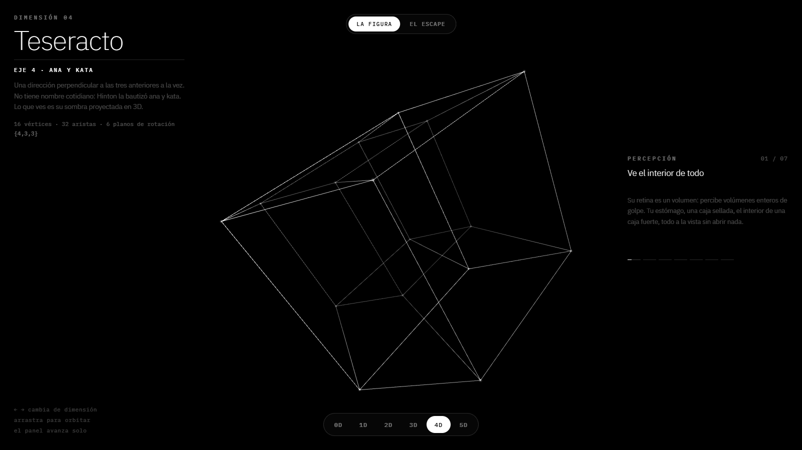
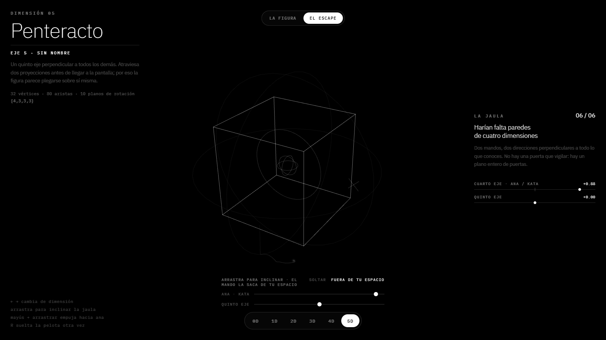

# Dimensional View

Un visor interactivo de dimensiones, del punto (0D) al penteracto (5D), pensado para que alguien
que no sabe nada de dimensiones termine entendiéndolas.

## Qué hace

- **La figura**: recorre punto, segmento, cuadrado, cubo, teseracto y penteracto con una
  transformación continua entre cada uno. Las figuras de 4D y 5D se proyectan hasta la pantalla y
  giran en todos sus planos de rotación. Un panel lateral explica qué cambia en cada dimensión con
  ejemplos de movimiento, percepción, geometría y física.
- **El escape**: una pelota encerrada en una jaula que sube de nivel con la dimensión. La pelota es
  un cuerpo con física real en cinco ejes: inclinar la jaula la hace rodar y rebotar. Hasta 3D no
  hay salida; en 4D y 5D se escapa por un eje que la jaula no puede tapar.

## Cómo abrirlo

Es un solo archivo: abre `index.html` en el navegador. Usa [three.js](https://threejs.org/) desde
un CDN, así que necesita conexión a internet.

- `←` `→` cambian de dimensión.
- Arrastra para orbitar la figura (o para inclinar la jaula en *El escape*).

## Tecnología

HTML, CSS y JavaScript sin dependencias de compilación, con three.js (WebGL) para el dibujo.
Las proyecciones de 5D a 4D a 3D y la física de la pelota están escritas a mano.
